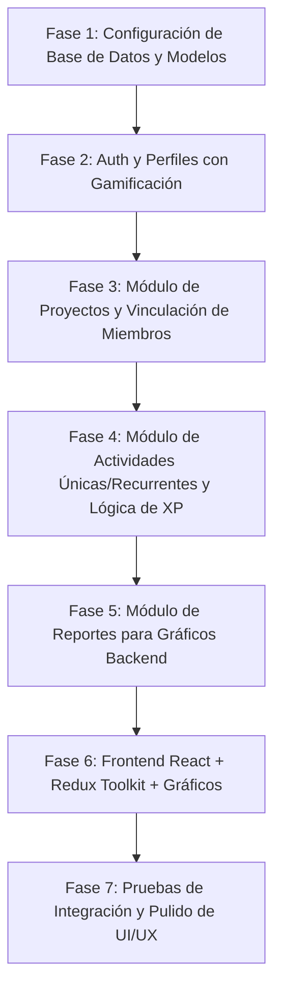

# 🎮 Plataforma Gamificada de Gestión de Actividades y Proyectos

Una plataforma web interactiva diseñada para organizar, gestionar y cumplir actividades —tanto de forma individual como en equipo— integrando dinámicas de **gamificación** (puntos, niveles, rachas, medallas) y **reportes visuales en tiempo real** mediante gráficos que permiten visualizar de un solo vistazo el progreso de cada acción y proyecto.

---

## 📌 Tabla de Contenidos
1. [Descripción General](#-descripción-general)
2. [Casos de Uso Principales](#-casos-de-uso-principales)
3. [Mecánicas de Gamificación](#-mecánicas-de-gamificación)
4. [Arquitectura y Stack Tecnológico](#-arquitectura-y-stack-tecnológico)
5. [Modelo de Datos y Entidades (Backend)](#-modelo-de-datos-y-entidades-backend)
6. [Módulos, Métodos y Endpoints API](#-módulos-métodos-y-endpoints-api)
7. [Arquitectura del Frontend (Redux Toolkit)](#-arquitectura-del-frontend-redux-toolkit)
8. [Plan de Implementación Paso a Paso](#-plan-de-implementación-paso-a-paso)

---

## 🚀 Descripción General

El sistema transforma la gestión de tareas tradicional en una experiencia atractiva y motivadora. Permite a los usuarios crear proyectos colaborativos o personales, registrar actividades puntuales (únicas) y hábitos continuos (recurrentes), y obtener recompensas tangibles en forma de experiencia (XP), niveles y medallas al completarlas a tiempo.

El núcleo de la plataforma es su **dashboard visual de avance**, donde mediante gráficos dinámicos (barras, líneas de tendencia, donuts de distribución) se refleja el rendimiento individual y el cumplimiento colectivo de los proyectos.

---

## 🎯 Casos de Uso Principales

- **CU-01: Autenticación y Perfil de Usuario**: Registro con credenciales seguras, inicio de sesión (JWT) y visualización del perfil gamificado (nivel actual, barra de XP, medallas y racha activa).
- **CU-02: Gestión de Actividades Únicas y Recurrentes**: 
  - Actividades únicas con fecha límite y recompensas asignadas.
  - Actividades recurrentes (diarias, semanales, mensuales) con registro histórico de cumplimiento por ciclo.
- **CU-03: Sistema de Gestión de Proyectos Colaborativos**: Creación de proyectos, asignación de roles (Propietario, Miembro) y vinculación de múltiples usuarios al equipo de trabajo.
- **CU-04: Motor de Gamificación**: Asignación automática de experiencia (XP), cálculo de nivel dinámico, conteo de racha de días consecutivos activos y desbloqueo de logros.
- **CU-05: Reportes y Gráficos Visuales de Progreso**:
  - Gráfico de dona/progreso general por proyecto (% de actividades completadas vs pendientes).
  - Gráfico de barras/líneas de velocidad semanal (actividades cumplidas por día/semana).
  - Historial de rachas y distribución de esfuerzo por miembro del equipo.

---

## 🏆 Mecánicas de Gamificación

| Elemento | Descripción |
|---|---|
| **Experiencia (XP)** | Cada actividad completada otorga puntos de experiencia según su dificultad e impacto. |
| **Niveles** | Cada umbral de XP alcanzado incrementa el nivel del usuario (ej. Novato, Avanzado, Maestro). |
| **Rachas (Streaks)** | Días consecutivos en los que el usuario completa al menos una actividad. |
| **Medallas / Logros** | Reconocimientos automáticos al cumplir hitos (ej. "Primer Proyecto Creado", "Racha de 7 días", "10 actividades en equipo"). |
| **Tabla de Posiciones (Leaderboard)** | Clasificación opcional dentro del equipo para fomentar una competencia sana. |

---

## 🛠️ Arquitectura y Stack Tecnológico

- **Backend**: [NestJS](https://nestjs.com/) (Node.js con TypeScript, arquitectura modular, controladores y servicios `async/await`).
- **Base de Datos**: PostgreSQL (`gamificacion_db`, puerto `5501`) con [TypeORM](https://typeorm.io/) (`synchronize: true`).
- **Frontend**: [React](https://react.dev/) + [Redux Toolkit](https://redux-toolkit.js.org/) (estado global obligatorio para sesión, proyectos, actividades y métricas) + Tailwind CSS + Chart.js / Recharts.
- **Autenticación**: JWT (JSON Web Tokens) con hashing de contraseñas mediante `bcrypt`.

---

## 🗄️ Modelo de Datos y Entidades (Backend)

### 1. `Usuario` (Tabla: `usuarios`)
Representa a los miembros de la plataforma y su estado gamificado.
- `id`: Int (PK autoincremental)
- `correo`: String (único)
- `contrasena`: String
- `nombre`: String (opcional)
- `avatarUrl`: String (opcional)
- `experiencia`: Int (puntos acumulados, default: 0)
- `nivel`: Int (nivel calculado, default: 1)
- `racha`: Int (días consecutivos activos, default: 0)
- `ultimaFechaActiva`: DateTime (para validar continuidad de racha)
- `fechaCreacion`, `fechaActualizacion`: Timestamps

### 2. `Proyecto` (Tabla: `proyectos`)
Contenedor de actividades individuales o en equipo.
- `id`: Int (PK)
- `nombre`: String
- `descripcion`: String (opcional)
- `color`: String (código HEX para visualización gráfica)
- `estado`: Enum (`ACTIVO`, `COMPLETADO`, `ARCHIVADO`)
- `propietarioId`: FK -> Usuario.id (creador del proyecto)
- `fechaCreacion`, `fechaActualizacion`: Timestamps

### 3. `MiembroProyecto` (Tabla: `miembros_proyecto`)
Tabla intermedia para vinculación de múltiples usuarios a proyectos.
- `id`: Int (PK)
- `proyectoId`: FK -> Proyecto.id
- `usuarioId`: FK -> Usuario.id
- `rol`: Enum (`PROPIETARIO`, `ADMINISTRADOR`, `MIEMBRO`)
- `fechaUnion`: Timestamp

### 4. `Actividad` (Tabla: `actividades`)
Representa tareas únicas o recurrentes.
- `id`: Int (PK)
- `titulo`: String
- `descripcion`: String (opcional)
- `tipo`: Enum (`UNICA`, `RECURRENTE`)
- `frecuencia`: Enum (`NINGUNA`, `DIARIA`, `SEMANAL`, `MENSUAL`)
- `recompensaExp`: Int (ej. 20, 50, 100 XP según dificultad)
- `estado`: Enum (`PENDIENTE`, `EN_PROGRESO`, `COMPLETADA`, `CANCELADA`)
- `fechaLimite`: DateTime (fecha límite para tareas únicas)
- `proyectoId`: FK -> Proyecto.id (opcional, null si es personal)
- `creadorId`: FK -> Usuario.id
- `asignadoId`: FK -> Usuario.id (opcional, usuario asignado)
- `fechaCreacion`, `fechaActualizacion`: Timestamps

### 5. `RegistroActividad` (Tabla: `registros_actividad`)
Crucial para alimentar las gráficas de progreso y registrar ciclos de actividades recurrentes.
- `id`: Int (PK)
- `actividadId`: FK -> Actividad.id
- `usuarioId`: FK -> Usuario.id (quién la completó)
- `experienciaGanada`: Int
- `notas`: String (opcional)
- `fechaCompletado`: Timestamp

### 6. `Medalla` (Tabla: `medallas`)
- `id`: Int (PK)
- `codigo`: String (ej. `FIRST_TASK`, `STREAK_7`, `PROJECT_MASTER`)
- `nombre`: String
- `descripcion`: String
- `icono`: String
- `experienciaRequerida`: Int (default: 0)
- `fechaCreacion`: Timestamp

### 7. `MedallaUsuario` (Tabla: `medallas_usuario`)
- `id`: Int (PK)
- `usuarioId`: FK -> Usuario.id
- `medallaId`: FK -> Medalla.id
- `fechaDesbloqueo`: Timestamp

---

## 📡 Módulos, Métodos y Endpoints API

### 🔐 1. Módulo de Autenticación (`AutenticacionModule` en `/src/autenticacion`)
- `POST /autenticacion/registro` -> `registrar(dto)`: Valida correo, hashea contraseña con `bcrypt`, inicializa usuario con nivel 1, 0 XP y racha 0, y retorna `{ token, usuario }`.
- `POST /autenticacion/login` -> `login(dto)`: Valida credenciales, genera y devuelve `{ token, usuario }`.
- `GET /autenticacion/perfil` *(Protegido con `JwtAuthGuard`)* -> `obtenerPerfil(req)`: Retorna información del usuario autenticado, nivel, experiencia, racha, proyectos y medallas.

### 👥 2. Módulo de Usuarios (`UsuarioModule` en `/src/usuario`)
- `POST /usuarios` -> `crear(dto)`: Crea un usuario (hasheando contraseña).
- `GET /usuarios` -> `obtenerTodos()`: Lista de usuarios ordenados por experiencia descendente.
- `GET /usuarios/:id` -> `obtenerPorId(id)`: Perfil de usuario específico con sus relaciones.
- `PATCH /usuarios/:id` -> `actualizar(id, dto)`: Actualizar datos del usuario.
- `DELETE /usuarios/:id` -> `eliminar(id)`: Eliminar usuario.

### 📁 3. Módulo de Proyectos (`ProyectoModule` en `/src/proyecto`)
- `POST /proyectos` -> `crear(dto)`: Crea proyecto y registra automáticamente al creador como `PROPIETARIO` en `miembros_proyecto`.
- `GET /proyectos` -> `obtenerTodos(usuarioId?)`: Lista proyectos con sus miembros, actividades y cálculo de `porcentajeAvance`.
- `GET /proyectos/:id` -> `obtenerPorId(id)`: Detalles del proyecto, miembros y progreso.
- `PATCH /proyectos/:id` -> `actualizar(id, dto)`: Edita nombre, descripción, color o estado.
- `DELETE /proyectos/:id` -> `eliminar(id)`: Elimina el proyecto.
- `POST /proyectos/:id/vincular` -> `vincularUsuario(id, body)`: Vincula a un usuario existente por `correo` o `usuarioId`.
- `DELETE /proyectos/:id/miembros/:usuarioId` -> `desvincularUsuario(id, usuarioId)`: Desvincula un miembro del proyecto.

### 🤝 4. Módulo de Miembros de Proyecto (`MiembroProyectoModule` en `/src/miembro-proyecto`)
- `POST /miembros-proyecto` -> `crear(dto)`: Crea una membresía directamente.
- `GET /miembros-proyecto` -> `obtenerTodos()`: Lista de miembros vinculados.
- `DELETE /miembros-proyecto/:id` -> `eliminar(id)`: Elimina un registro de membresía.

### ✅ 5. Módulo de Actividades (`ActividadModule` en `/src/actividad`)
- `POST /actividades` -> `crear(dto)`: Registra una actividad única o recurrente (con frecuencia, experiencia y asignado).
- `GET /actividades` -> `obtenerTodas(filtros)`: Lista actividades con filtros opcionales (`proyectoId`, `usuarioId`, `tipo`, `estado`).
- `GET /actividades/:id` -> `obtenerPorId(id)`: Detalles de la actividad y sus registros de cumplimiento.
- `PATCH /actividades/:id` -> `actualizar(id, dto)`: Actualiza propiedades de la actividad.
- `DELETE /actividades/:id` -> `eliminar(id)`: Elimina la actividad.
- `POST /actividades/:id/completar` -> `completar(id, body)`: Marca la actividad completada, crea un `RegistroActividad`, suma experiencia, recalcula nivel y racha, y desbloquea medallas automáticamente.

### 📝 6. Módulo de Registros de Actividad (`RegistroActividadModule` en `/src/registro-actividad`)
- `POST /registros-actividad` -> `crear(dto)`: Registra manualmente un cumplimiento.
- `GET /registros-actividad` -> `obtenerTodos()`: Historial completo de cumplimientos.

### 🏅 7. Módulo de Medallas y Logros (`MedallaModule` y `MedallaUsuarioModule`)
- `GET /medallas` -> `obtenerTodas()`: Catálogo de medallas (se siembran 4 medallas base automáticamente al iniciar).
- `POST /medallas-usuario` -> `crear(dto)`: Otorga una medalla a un usuario.

### 📊 8. Módulo de Reportes (`ReporteModule` en `/src/reporte`)
- `GET /reportes/general` -> `obtenerReporteGeneral(usuarioId?)`: Devuelve `resumen`, `avancePorProyecto`, `actividadesPorEstado`, `actividadesPorTipo`, `progresoPorAccion` e `historialPorFecha` listo para graficar.
- `GET /reportes/proyecto/:id` -> `obtenerReporteProyecto(id)`: Devuelve el reporte detallado de un proyecto y `rendimientoMiembros`.

---

## 💻 Arquitectura del Frontend (Redux Toolkit)

La gestión de estado se estructurará con **Redux Toolkit** dividida en los siguientes slices:

1. **`authSlice`**: Estado del usuario autenticado, token JWT, nivel actual, XP, racha y estado de carga.
2. **`projectsSlice`**: Lista de proyectos activos, proyecto seleccionado, miembros del proyecto y estado CRUD.
3. **`activitiesSlice`**: Listado de actividades (filtrables por proyecto, tipo o estado), modal de creación/edición y acciones de completado inmediato con feedback de XP.
4. **`reportsSlice`**: Datos agregados y formateados para alimentar directamente los componentes de gráficos (Recharts / Chart.js).
5. **`gamificationSlice`**: Notificaciones de recompensas (animaciones al subir de nivel, ganar medallas o sumar XP).

---

## 📋 Plan de Implementación Paso a Paso

1. **Fase 1: Configuración de BD y ORM**:
   - Configurar Prisma en el proyecto NestJS (`backend`).
   - Crear el esquema con las entidades (`User`, `Project`, `ProjectMember`, `Activity`, `ActivityLog`, `Badge`, `UserBadge`).
   - Ejecutar la migración inicial.

2. **Fase 2: Autenticación & Perfiles**:
   - Implementar JWT Strategy, Passport y Guards de autenticación.
   - Endpoints de registro, login y perfil gamificado (`/auth/profile`).

3. **Fase 3: Gestión de Proyectos**:
   - CRUD de proyectos.
   - Lógica para vincular y desvincular usuarios del proyecto con roles.

4. **Fase 4: Gestión de Actividades & Motor de Gamificación**:
   - CRUD de actividades únicas y recurrentes.
   - Lógica de negocio al completar actividad: cálculo de XP, subida de nivel, racha de días y registro en `ActivityLog`.

5. **Fase 5: Métricas y Endpoints para Gráficos**:
   - Agregaciones en base de datos para responder a las gráficas (tendencia semanal, dona de proyectos, distribución de tareas).

6. **Fase 6: Frontend con Redux Toolkit**:
   - Inicializar el frontend (React + Vite + Tailwind + Redux Toolkit).
   - Configurar Store y Slices (`auth`, `projects`, `activities`, `reports`).
   - Integrar componentes de gráficos (Recharts / Chart.js).
   - Diseñar dashboard con vista general de progreso y barras de gamificación.

7. **Fase 7: Verificación y Entrega**:
   - Probar flujo completo: Registro -> Crear Proyecto -> Invitar miembro -> Crear tarea única y recurrente -> Completar tarea -> Ver subida de XP y actualización inmediata de gráficos.
